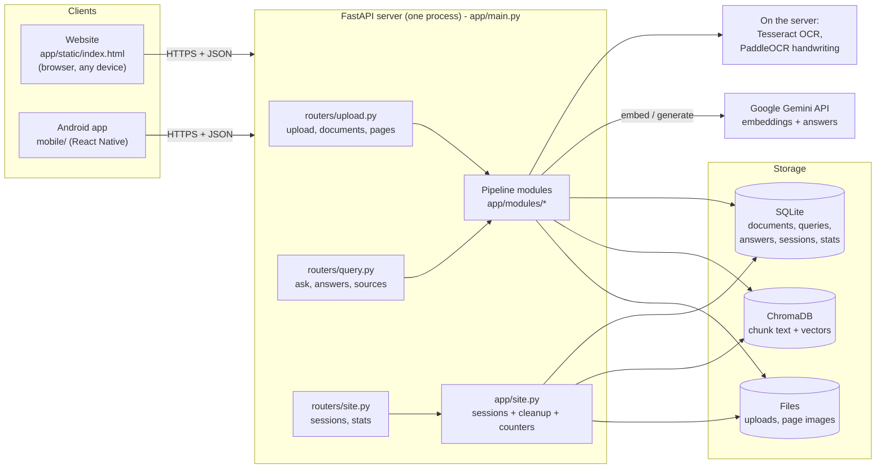
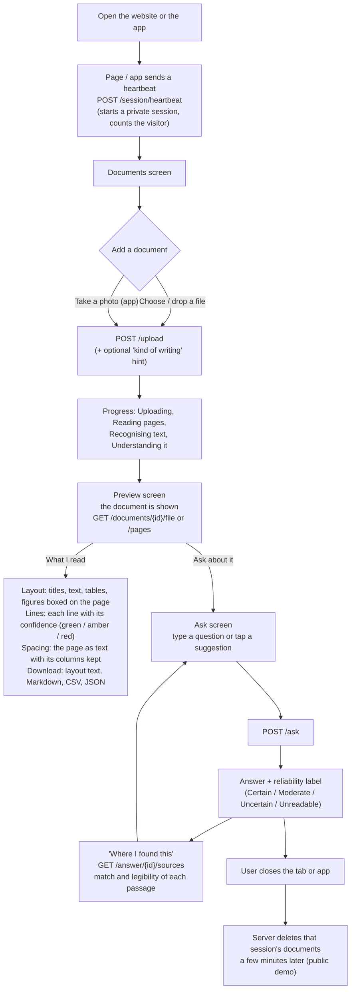
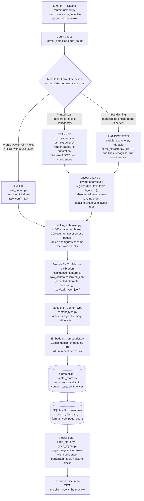
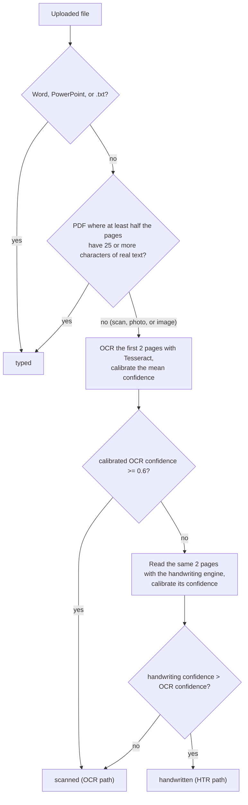
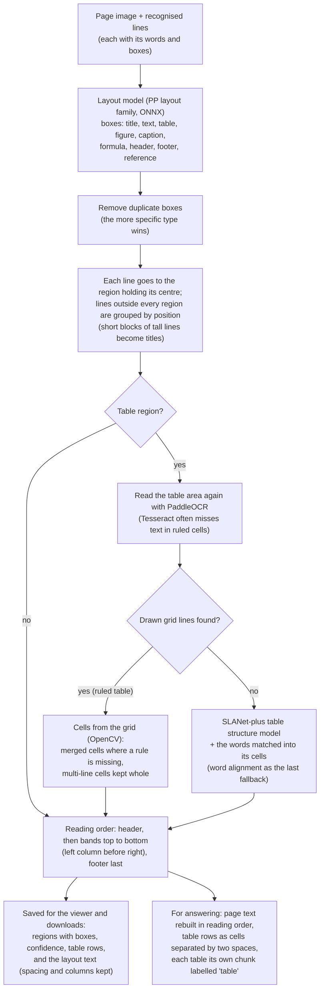
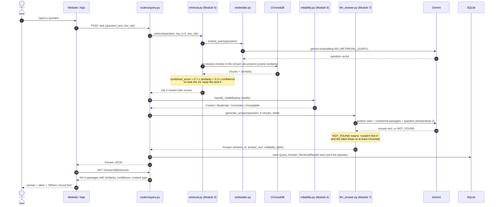
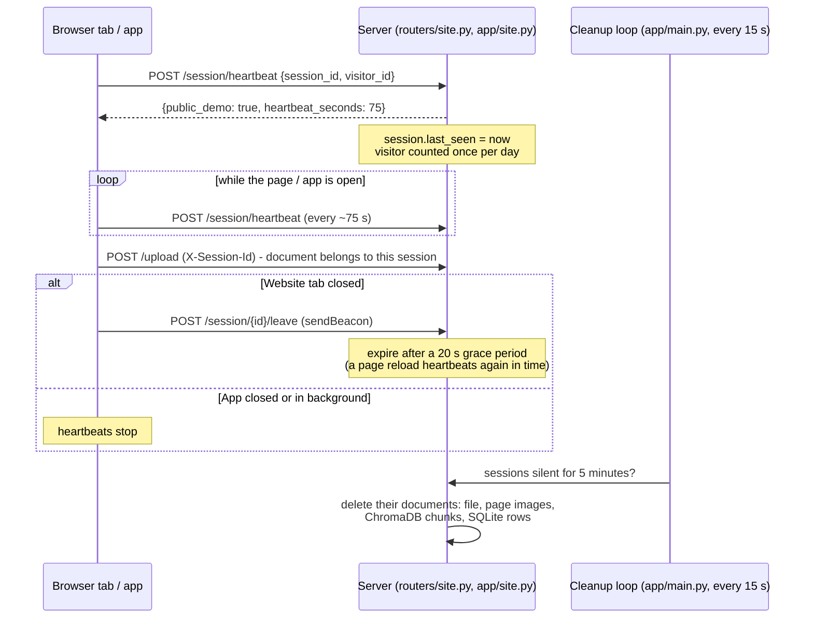
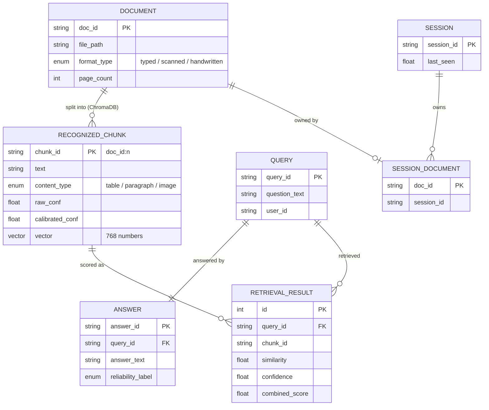

# DocBlendAI

**Version 1.3.0** · Final-year B.Tech project (Group C4), Dept. of CSE, PRMIT&R Badnera

Confidence-aware multi-format document QA assistant: upload typed, scanned, or
handwritten academic documents and ask questions. Every answer carries a reliability
tier (**Certain / Moderate / Uncertain / Unreadable**) that says how far you can trust it.

- **Website:** https://docblendai.onrender.com
- **Android app:** [download the APK](https://github.com/gauravkal006/DocBlendAI/raw/main/mobile/DocBlendAI.apk) · source in [mobile/](mobile/README.md)

**Supported uploads:** PDF, images (JPG, PNG, TIFF incl. multi-page, BMP, WEBP;
phone photos are turned upright automatically), Word (.docx, including tables),
PowerPoint (.pptx, one page per slide), and plain text (.txt). See `PROJECT_NOTES.md` for full
project context.

**Contributors:** [Darshana Rekhate](https://github.com/darshanarekhate) · [Gaurav Kalamkhede](https://github.com/gauravkal006) · [Om Upadhye](https://github.com/om-upadhye)

**Team members:** start with [CONTRIBUTING.md](CONTRIBUTING.md) for the Git workflow and troubleshooting.

## Contents

1. [How it works in one picture](#1-how-it-works-in-one-picture)
2. [What the user does (website and app)](#2-what-the-user-does-website-and-app)
3. [What happens when a document is uploaded](#3-what-happens-when-a-document-is-uploaded)
4. [How a question is answered](#4-how-a-question-is-answered)
5. [Sessions, privacy, and automatic cleanup](#5-sessions-privacy-and-automatic-cleanup)
6. [Where data is stored](#6-where-data-is-stored)
7. [The 7 modules and where each one lives](#7-the-7-modules-and-where-each-one-lives)
8. [API reference (website and app)](#8-api-reference-website-and-app)
9. [Installation and running](#what-you-need)

---

## 1. How it works in one picture

Two front ends (the website and the Android app) talk to **one FastAPI server** over the same
HTTP API. The server does all the work: it reads documents (direct parsing, OCR, or handwriting
recognition), stores them, finds the passages that answer a question, and asks **Gemini** to write
the answer. Gemini is only ever called by the server, so the API key never reaches a browser or phone.



| Piece | Technology | Role |
|---|---|---|
| Website | Plain HTML/CSS/JS, one file | Upload, preview, chat; adapts to phones with bottom tabs |
| Android app | React Native 0.87 (TypeScript) | Same features as native screens; camera upload |
| Server | FastAPI (Python 3.11), single monolith | All 7 modules, separated by files, not by network |
| Typed text | pdfplumber, python-docx, python-pptx | Read the text that is already digital |
| Printed scans | Tesseract (pytesseract) | OCR with word confidences, page-orientation fix |
| Handwriting | PaddleOCR PP-OCRv6 via RapidOCR / ONNX Runtime (TrOCR optional) | Line detection + recognition with line confidences |
| Layout & tables | PP layout model (rapid-layout), drawn-grid reading (OpenCV), SLANet-plus (rapid-table), all ONNX | Titles / text / tables / figures / captions / headers / footers, table cells, reading order, spacing |
| Vectors | ChromaDB | Chunk embeddings and similarity search |
| Relational data | SQLite + SQLAlchemy | Documents, questions, answers, scores, sessions, counters |
| LLM | Gemini `gemini-embedding-001` + `gemini-3.5-flash-lite` (google-genai SDK) | Embeddings and grounded answers |
| Hosting | Docker on Render (`render.yaml`) | Public demo |

---

## 2. What the user does (website and app)



**On the website** the three areas (documents, preview, chat) sit side by side on a laptop; on a
phone they become three screens switched with a bottom tab bar. **The Android app** has the same
three tabs, plus **Take photo** for handwritten or printed notes. The header of both shows
*visitors today* and *questions today*.

---

## 3. What happens when a document is uploaded

`POST /upload` runs the whole ingestion pipeline in one request
([app/routers/upload.py](app/routers/upload.py) → `_ingest`). Each step is one module file:



### How the format is decided (Module 2)



The user can skip detection with the *kind of writing* choice (`format_hint`); Word, PowerPoint,
and text files are always typed, and an image can never be typed.

### Layout analysis: regions, tables, reading order, spacing

Scanned and handwritten pages go through [app/modules/layout_analysis.py](app/modules/layout_analysis.py)
right after recognition (about 0.3–1 s per page, plus a few seconds per table):



- **Typed PDFs** keep their exact text; their paragraphs, tables, and pictures come from the PDF
  itself ([typed_layout.py](app/modules/typed_layout.py)) and the layout text from pdfplumber's
  layout mode. Word, PowerPoint, and text files are laid out from their own structure.
- **Downloads** ([exporters.py](app/modules/exporters.py)): layout text (spacing kept), Markdown
  (titles as headings, tables as Markdown tables), tables as CSV (a zip when there are several),
  JSON (everything), and plain text: `GET /documents/{id}/export?format=...`.
- **Models:** the layout model is bundled with rapid-layout (~7 MB); SLANet-plus (~7 MB)
  downloads once (the Docker image includes it). `LAYOUT_MODEL=pp_doc_layoutv2` switches to
  PP-StructureV3's larger PP-DocLayout model.

### What each step produces

| Step | File | Input → output |
|---|---|---|
| Upload | `routers/upload.py` | file → saved file, `doc_id` (random 32-hex id) |
| Detect | `modules/format_detection.py` | file → `typed` / `scanned` / `handwritten` |
| Extract | `text_parser.py`, `ocr_extractor.py`, `paddle_extractor.py`, `htr_extractor.py` | file → list of `(page_text, raw_conf)` |
| Page images | `pdf_render.py` | PDF pages / photos → upright, denoised grayscale images |
| Layout | `layout_analysis.py` | page image + lines → regions, table rows, reading-order text, layout text |
| Chunk | `chunker.py` | pages (or their layout regions) → `RecognizedChunk`s with ids `"<doc_id>:<n>"`; tables kept whole |
| Calibrate | `confidence_capture.py` | `raw_conf` → `calibrated_conf` (typed is always 1.0) |
| Label | `content_type.py` | chunk text → `table` / `paragraph` / `image` (a label from layout analysis is kept) |
| Embed | `embedder.py` | chunk text → 768-number vector (Gemini, task `RETRIEVAL_DOCUMENT`) |
| Store | `vector_store.py`, `db/models.py` | chunks → ChromaDB; `Document` → SQLite |
| Viewer | `page_store.py`, `typed_layout.py` | page images + line boxes + regions + blocks + layout text → `uploads/<doc_id>_pages/` |

If anything fails, nothing half-finished is left behind: the saved file is removed, and vectors are
deleted if the database row cannot be written.

---

## 4. How a question is answered

`POST /ask` ([app/routers/query.py](app/routers/query.py)) runs Modules 5 → 6 → 7:



### Step by step

1. **Embed the question** (`embedder.embed_query`): Gemini turns the question into a vector, using
   the query-side task type so it matches document vectors well.
2. **Search** (`vector_store.search`): ChromaDB returns the 15 most similar chunks
   (`top_k 5 × candidate_multiplier 3`), only from the documents the user ticked (`doc_ids`).
3. **Confidence-aware re-ranking** (`retrieval.combined_score`):

   ```
   combined_score = 0.7 × similarity + 0.3 × calibrated_confidence
   ```

   A relevant chunk that was read clearly beats a slightly more similar one that was badly
   recognised. The best 5 are kept. (`SIMILARITY_WEIGHT`, `TOP_K` in settings.)
4. **Reliability tier** (`reliability.classify_reliability`), from the top chunk's two scores:

   | Label | Rule (top chunk) | Meaning shown to the user |
   |---|---|---|
   | **Unreadable** | confidence < 0.35 | The part that answers this was too hard to read |
   | **Certain** | similarity ≥ 0.65 and confidence ≥ 0.85 | Clearly written in your document |
   | **Moderate** | similarity ≥ 0.58 and confidence ≥ 0.60 | Found, but the match was loose or words were hard to read |
   | **Uncertain** | anything else, or no evidence | Couldn't find strong support; check the source |

5. **Prompt Gemini** (`llm_answer.build_prompt`): the 5 passages are numbered, each marked with its
   content type, and passages read with confidence below 0.95 are flagged *"recognized text, may
   contain recognition errors"*. The system instruction tells Gemini to use **only** these passages,
   never outside knowledge, to correct only obvious misreadings, and to reply exactly `NOT_FOUND`
   if the answer is not there. Temperature 0 keeps answers repeatable; busy or rate-limited
   calls are retried up to 3 times.
6. **Answer**: `NOT_FOUND` becomes *"I couldn't find the answer to that in the uploaded
   documents."* and the label is lowered to at least Uncertain.
7. **Store**: the question, the answer, and each retrieved chunk's scores are saved in SQLite, so
   `GET /answer/{id}/sources` can show the evidence later.

---

## 5. Sessions, privacy, and automatic cleanup

On the hosted demo (`PUBLIC_DEMO=true`) every browser tab or app launch is a private **session**:
it sends a random `X-Session-Id` header with every request, sees only its own documents, and its
files are deleted when the user leaves ([app/site.py](app/site.py)).



- `visitor_id` is stored in the browser (`localStorage`) or the app (`AsyncStorage`) so one person
  counts once per day; `session_id` is new per tab / app launch.
- Counters (`GET /stats`): **visitors today** = distinct visitors with a heartbeat today,
  **questions today** = answered questions today. Days roll over at midnight India time.
- Locally (`PUBLIC_DEMO` unset) nothing is deleted and every document is visible: the team's
  normal development mode.

---

## 6. Where data is stored



| What | Where | Code |
|---|---|---|
| Document, Query, Answer, RetrievalResult (the synopsis entities) | SQLite `data/docblendai.db` | `app/db/models.py`, shapes in `app/models/schemas.py` |
| RecognizedChunk text + vector + confidences | ChromaDB `data/chroma_db/` | `app/modules/vector_store.py` |
| Uploaded files | `data/uploads/<doc_id>_<name>.<ext>` | `routers/upload.py` |
| Page images, line boxes, blocks, pictures | `data/uploads/<doc_id>_pages/` | `modules/page_store.py` |
| Sessions, visits, daily question counts | SQLite (`sessions`, `session_documents`, `visits`, `daily_questions`) | `app/db/models.py`, `app/site.py` |
| Confidence calibration tables | `data/calibration.json` (committed) | `modules/confidence_capture.py` |

In Docker / Render everything above lives under `/data` (`DATABASE_URL`, `CHROMA_DIR`, `UPLOAD_DIR`).

---

## 7. The 7 modules and where each one lives

| # | Module (synopsis) | Files | Main functions |
|---|---|---|---|
| 1 | Document Upload | `routers/upload.py`, `modules/file_types.py` | `upload_document`, `_ingest`, `kind_of` |
| 2 | Format Detection & Text Extraction | `modules/format_detection.py`, `text_parser.py`, `ocr_extractor.py`, `paddle_extractor.py`, `htr_extractor.py`, `pdf_render.py` | `resolve_format`, `detect_format`, `extract`, `ocr_file`, `paddle_file`, `auto_orient` |
| 3 | Confidence Capture & Calibration | `modules/confidence_capture.py` | `calibrate`, `apply_calibration`, `fit_calibration` |
| 4 | Content-Type Identification | `modules/content_type.py`, `layout_analysis.py`, `typed_layout.py`, `chunker.py`, `exporters.py` | `classify`, `label_chunks`, `analyze_page`, `grid_rows`, `chunk_pages` |
| 5 | Confidence-Aware Retrieval (RAG) | `modules/retrieval.py`, `embedder.py`, `vector_store.py` | `retrieve`, `combined_score`, `embed_query`, `search` |
| 6 | Reliability Tier Classification | `modules/reliability.py` | `classify_reliability`, `worse_of` |
| 7 | LLM Answer Generation | `modules/llm_answer.py` | `build_prompt`, `generate_answer` |
| – | Website support (not a synopsis module) | `app/site.py`, `routers/site.py` | sessions, cleanup, `/stats` |
| – | Front ends | `app/static/index.html`, `mobile/` | website, Android app |

---

## 8. API reference (website and app)

Interactive docs with a "Try it out" button: `/docs` on any running server
(e.g. https://docblendai.onrender.com/docs).

**Common rules**

- Base URL: `https://docblendai.onrender.com` (or `http://127.0.0.1:8000` locally).
- JSON in and out, except `/upload` (multipart form) and the file / image endpoints.
- Header `X-Session-Id: <8-64 letters, digits, dashes>` on every call from the website and the
  app. Required when `PUBLIC_DEMO=true` (otherwise `400 Missing session`).
- Errors come back as `{"detail": "human-readable message"}`; both clients show `detail` to the user.

### Endpoints at a glance

| Method | Path | Purpose | Website | App |
|---|---|---|---|---|
| GET | `/health` | Server is up (`{"status": "ok"}`); Render's health check | – | – |
| POST | `/session/heartbeat` | Start / keep a session alive, count the visitor | ✔ | ✔ |
| POST | `/session/{session_id}/leave` | Tab closing: delete its documents after a short grace period | ✔ | – |
| GET | `/stats` | Visitors and questions today and in total | ✔ | ✔ |
| POST | `/upload` | Upload and process a document | ✔ | ✔ |
| GET | `/documents` | This session's documents, oldest first | ✔ | ✔ |
| DELETE | `/documents/{doc_id}` | Remove a document everywhere | ✔ | ✔ |
| GET | `/documents/{doc_id}/file` | The original file, for the preview | ✔ | ✔ (images) |
| GET | `/documents/{doc_id}/pages` | Per-page text, recognised lines, layout regions, blocks, layout text, image links | ✔ | ✔ |
| GET | `/documents/{doc_id}/export?format=` | Download: `layout` (spacing kept), `md`, `csv` (tables), `json`, `txt` | ✔ | ✔ |
| GET | `/documents/{doc_id}/pages/{n}/image` | Page image that recognition read | ✔ | ✔ |
| GET | `/documents/{doc_id}/pictures/{name}` | A picture found in a typed document | ✔ | – |
| POST | `/ask` | Ask a question → answer + reliability label | ✔ | ✔ |
| GET | `/answer/{answer_id}` | Fetch a stored answer | – | – |
| GET | `/answer/{answer_id}/sources` | Passages behind an answer, with scores | ✔ | ✔ |

### How the clients call the API

| Client | Where the calls are | How |
|---|---|---|
| Website | `app/static/index.html` → `api()` helper | `fetch(path, options)` with `X-Session-Id` added to every call; heartbeat every ~75 s; `navigator.sendBeacon` to `/leave` on `pagehide` |
| Android app | `mobile/src/api.ts` | `request()` wraps `fetch` with the server URL (`src/config.ts`), `X-Session-Id`, and timeouts (90 s for the first heartbeat while the free server wakes up, 10 min for uploads) |

### Session and counters

**`POST /session/heartbeat`**

```json
// request
{"session_id": "3f2b0c1e-9a7d-4c1b-8e2f-5d6a7b8c9d0e", "visitor_id": "b1c2d3e4-f5a6-4b7c-8d9e-0f1a2b3c4d5e"}
// response
{"public_demo": true, "heartbeat_seconds": 75}
```

**`POST /session/{session_id}/leave`** → `204 No Content`. Sent by the website with
`navigator.sendBeacon` when the tab closes.

**`GET /stats`**

```json
{"visitors_today": 12, "questions_today": 34, "visitors_total": 80, "questions_total": 215}
```

### Documents

**`POST /upload`** (multipart form: `file`, optional `format_hint` = `typed` | `scanned` | `handwritten`) → `201`

```bash
curl -X POST https://docblendai.onrender.com/upload \
  -H "X-Session-Id: demo-session-0001" \
  -F "file=@notes.pdf" -F "format_hint=handwritten"
```

```json
{"doc_id": "75a30c9d541842a79930c2b406c8237b",
 "file_path": "/data/uploads/75a30c9d541842a79930c2b406c8237b_notes.pdf",
 "format_type": "handwritten", "page_count": 3}
```

Errors: `413` file too large / too many pages (`MAX_UPLOAD_MB`, `MAX_PAGES`), `415` unsupported
type, `422` unreadable file or no readable text, `502` Gemini embedding failed, `503` OCR engine
missing on the server.

Website: `FormData` with the dropped / chosen `File`. App: `FormData` with `{uri, name, type}` from
the file picker or camera (`uploadDocument` in `src/api.ts`).

**`GET /documents`** → `[Document, ...]` (oldest first; on the demo only this session's)

**`DELETE /documents/{doc_id}`** → `204`. Deletes the ChromaDB chunks, the file, the page view,
and the row. Past answers stay, without this document in their sources.

**`GET /documents/{doc_id}/file`** → the original upload. PDFs, images, and text open inline
(the website shows PDFs in its preview panel); Word and PowerPoint download.

**`GET /documents/{doc_id}/pages`**

```json
[
  {"page": 1, "text": "Semester Results\n\nName  DSA  Total\nAsha  91  258", "conf": 0.82,
   "image_url": "/documents/75a3.../pages/1/image",
   "lines": [{"text": "Semester Results", "conf": 0.91, "box": [0.08, 0.05, 0.62, 0.09],
              "words": [{"text": "Semester", "conf": 0.93, "box": [0.08, 0.05, 0.33, 0.09]}]}],
   "regions": [
     {"type": "title", "box": [0.08, 0.05, 0.62, 0.09], "text": "Semester Results", "conf": 0.91},
     {"type": "table", "box": [0.08, 0.2, 0.89, 0.4], "text": "Name  DSA  Total\nAsha  91  258",
      "conf": 0.97, "rows": [["Name", "DSA", "Total"], ["Asha", "91", "258"]]}],
   "blocks": [],
   "layout_text": "Semester Results\n\n Name     DSA     Total\n Asha     91      258"}
]
```

`lines` (scans and handwriting): each recognised line with its words, calibrated confidence, and
box as fractions of the page. `regions` (scans and handwriting): the layout in reading order
(title, text, table with `rows`, figure, caption, formula, header, footer, reference). `blocks`
(typed files): paragraphs, tables (`rows`), and pictures (`picture_url`). `layout_text`: the page
with its spacing and columns kept. Used by the website's viewer (Layout / Lines / Spacing) and by
the app's Preview tab.

**`GET /documents/{doc_id}/export?format=layout|md|csv|json|txt`** → a file download
(`Content-Disposition: attachment`), e.g. `notes_layout.txt`, `notes.md`, `notes_tables.csv`
(or `.zip` with one CSV per table), `notes.json`, `notes.txt`. `404` for `csv` when no table was
found. Like `/file`, the random `doc_id` is the access key, so the app opens it in the phone's browser.

### Questions and answers

**`POST /ask`**

```json
// request
{"query_id": "a-new-uuid", "question_text": "What does the retriever select?",
 "user_id": "web", "doc_ids": ["75a30c9d541842a79930c2b406c8237b"]}
// response
{"answer_id": "e4f1...", "answer_text": "The retriever selects relevant passages.",
 "reliability_label": "Certain"}
```

`doc_ids` limits the search to those documents (on the demo: only your own; omitted = all of
yours). `user_id` is `"web"` from the website and `"android-app"` from the app. Errors: `409`
repeated `query_id`, `422` no / unknown documents, `502` Gemini failed (e.g. daily quota used up).

**`GET /answer/{answer_id}/sources`**

```json
[{"chunk_id": "75a3...:0", "doc_id": "75a3...", "content_type": "paragraph",
  "text": "Retrieval-Augmented Generation combines ...",
  "similarity": 0.74, "confidence": 1.0, "combined_score": 0.818}]
```

Best `combined_score` first; shown under "Where I found this" with *match* (similarity) and
*legibility* (confidence) bars.

---

## What you need

| Component | Version | How you get it |
|---|---|---|
| Python | **3.11** (tested 3.11.9) | https://www.python.org/downloads/release/python-3119/ (tick "Add python.exe to PATH") |
| Python packages | pinned in [`requirements.txt`](requirements.txt) | `pip install -r requirements.txt` (step 3 below) |
| Tesseract OCR | **5.4.0** (UB Mannheim build, includes `eng` + `osd` data) | `winget install UB-Mannheim.TesseractOCR` |
| Handwriting engine (default) | PaddleOCR **PP-OCRv6** models via RapidOCR 3.9.2 + ONNX Runtime 1.30.0 (~30 MB, bundled; no PaddlePaddle, no GPU) | installed with `requirements.txt` |
| TrOCR handwriting model (optional, `HTR_ENGINE=trocr`) | `microsoft/trocr-small-handwritten` (~250 MB) | downloaded by `scripts.setup_models` (step 5) into `%USERPROFILE%\.cache\huggingface` |
| Gemini API key | free tier works | https://aistudio.google.com/apikey |
| Gemini models (cloud) | `gemini-embedding-001` (embeddings), `gemini-3.5-flash-lite` (answers) | nothing to download; set in `.env` if you want others |

Main package versions: FastAPI 0.141.1 · ChromaDB 1.5.9 · SQLAlchemy 2.0.54 · google-genai 2.25.0 ·
PyTorch 2.14.0 (CPU) · transformers 5.17.0 · pytesseract 0.3.13 · pdfplumber 0.11.10 · jiwer 4.0.0.

## Installation (Windows)

1. **Get the code** (collaborators on the private repo):
   ```bash
   git clone https://github.com/om-upadhye/DocBlendAI.git
   cd DocBlendAI
   ```
2. **Create a Python 3.11 virtual environment:**
   ```bash
   py -3.11 -m venv venv
   ```
3. **Install the pinned packages** (PyTorch is large, so the first install takes a while):
   ```bash
   venv/Scripts/python -m pip install --upgrade pip
   venv/Scripts/python -m pip install -r requirements.txt
   ```
   With an NVIDIA GPU, first install `torch==2.14.0` and `torchvision==0.29.0` for your CUDA
   version from https://pytorch.org/get-started/locally/, then run the line above.
4. **Install Tesseract OCR:**
   ```bash
   winget install UB-Mannheim.TesseractOCR
   ```
   The default location (`C:\Program Files\Tesseract-OCR`) is found automatically; otherwise set
   `TESSERACT_CMD` in `.env` to the full path of `tesseract.exe`.
5. **Add your Gemini key and download the model:** copy `.env.example` to `.env`, put your key after
   `GEMINI_API_KEY=`, then run the setup check. It downloads the TrOCR model and reports anything missing:
   ```bash
   venv/Scripts/python -m scripts.setup_models
   ```
   > Never put a real key in `.env.example`: that file is committed; `.env` is not.

## Running

```bash
venv/Scripts/python -m uvicorn app.main:app --reload
```

- **App:** http://127.0.0.1:8000/ to upload documents, tick which ones to ask about, ask questions, and see reliability labels and sources.
  **View** on a document opens the page viewer: each page image with every recognised line boxed and
  coloured by confidence (green clear / amber partly legible / red poor), next to the recognised text.
  Typed documents instead show what each part is: paragraphs (blue), tables (purple), and pictures
  (amber), boxed on the page for PDFs and laid out in order for Word, PowerPoint, and text files.
- **API docs:** http://127.0.0.1:8000/docs

If the server refuses to start with "database is out of date", delete `data/docblendai.db`
and the contents of `data/chroma_db/` (local dev data), restart, and re-upload.

**Hosting on Render:** see [DEPLOY.md](DEPLOY.md) (one-click Blueprint in `render.yaml`).

**Android app:** a React Native app for the same server is in [mobile/](mobile/README.md) (shareable APK).

## Running with Docker (for hosting)

Needs [Docker Desktop](https://www.docker.com/products/docker-desktop/). With your key in `.env`:

```bash
docker compose up --build
```

Then open http://localhost:8000. The image includes Tesseract and the PaddleOCR handwriting models;
documents, the database, and vectors are kept in the `docblendai-data` volume (mounted at `/data`), so
they survive restarts. Without compose:

```bash
docker build -t docblendai .
docker run -p 8000:8000 -e GEMINI_API_KEY=your-key -v docblendai-data:/data docblendai
```

- The optional TrOCR engine (`HTR_ENGINE=trocr`) needs PyTorch, which is left out to keep the image
  small; build with `--build-arg WITH_TROCR=true` to include it.
- Hosts that choose the port (Render, Railway, Hugging Face Spaces) set `PORT`; the image listens on it
  (default 8000). Set `GEMINI_API_KEY` as a secret in the host's settings, never in the image.
- Without a persistent disk on the host, uploaded documents are lost when the container restarts.

## Settings

All optional except the key; put them in `.env` (local) or the host's environment (Render).

| Variable | Default | Meaning |
|---|---|---|
| `GEMINI_API_KEY` | – | Gemini key for embeddings and answers |
| `LLM_MODEL` / `EMBEDDING_MODEL` | `gemini-3.5-flash-lite` / `gemini-embedding-001` | Gemini models |
| `TOP_K` | 5 | Passages per answer |
| `SIMILARITY_WEIGHT` | 0.7 | Weight of similarity in `combined_score` (the rest is confidence) |
| `HTR_ENGINE` | `paddle` | Handwriting engine: `paddle` or `trocr` |
| `LAYOUT_ANALYSIS` | true | Layout regions on scanned / handwritten pages (false: lines grouped by position only) |
| `LAYOUT_MODEL` | `pp_layout_cdla` | Layout model; `pp_doc_layoutv2` / `v3` = PP-StructureV3's PP-DocLayout (larger) |
| `TABLE_MODEL` | `slanet_plus` | Structure model for tables without drawn lines (empty: word alignment) |
| `TABLE_REREAD` | true | Read table areas again with PaddleOCR (Tesseract often misses ruled-cell text) |
| `PUBLIC_DEMO` | false | Private per-tab sessions with automatic deletion (true on Render) |
| `SESSION_TTL_SECONDS` | 300 | Delete a silent session's documents after this long |
| `MAX_UPLOAD_MB` / `MAX_PAGES` | 0 (no limit) | Upload limits (20 MB / 30 pages on Render) |

## Testing and evaluation

```bash
venv/Scripts/python -m pytest
venv/Scripts/python -m evaluation.make_dataset
venv/Scripts/python -m evaluation.run_eval --fit-calibration
```

Tests fake Tesseract, TrOCR, and Gemini, so they run offline. The evaluation uses the
real engines: it generates a synthetic dataset (typed, degraded scans, handwriting-style
fonts), measures CER/WER, fits confidence calibration into `data/calibration.json`,
and scores question answering (Exact Match, Semantic Match, retrieval hits, accuracy per
reliability tier). The latest report is in [evaluation/results/report.md](evaluation/results/report.md).

## Folder structure

```
app/
├── main.py                  FastAPI app, router registration, /health, serves the UI, cleanup loop
├── config.py                Settings from .env (pydantic-settings)
├── site.py                  Website support: sessions, document cleanup, visitor/question counters
├── static/index.html        Website (desktop + phone layouts)
├── routers/
│   ├── upload.py            Module 1: POST /upload, GET/DELETE /documents, file/pages/images
│   ├── query.py             POST /ask, GET /answer/{id}[/sources] (Modules 5-7)
│   └── site.py              POST /session/heartbeat, /session/{id}/leave, GET /stats
├── modules/
│   ├── format_detection.py  Module 2: detect format, route to an extractor
│   ├── text_parser.py       Module 2: direct parsing of PDF / Word / PowerPoint / text
│   ├── file_types.py        Modules 1-2: supported upload formats
│   ├── pdf_render.py        Module 2: PDF pages / image files -> page images, denoise
│   ├── ocr_extractor.py     Module 2: pytesseract OCR, page-orientation correction
│   ├── paddle_extractor.py  Module 2: handwriting via PaddleOCR PP-OCRv6 (default engine)
│   ├── htr_extractor.py     Module 2: TrOCR HTR (optional engine), ruled-notebook segmentation
│   ├── page_store.py        Modules 1-2: page images, line boxes, regions, layout text for the viewer
│   ├── layout_analysis.py   Modules 2/4: layout regions, tables (grid / SLANet-plus), reading order, spacing
│   ├── exporters.py         Downloads: layout text, Markdown, CSV tables, JSON, plain text
│   ├── typed_layout.py      Module 4: paragraphs / tables / pictures of typed files, for the viewer
│   ├── confidence_capture.py Module 3: raw -> calibrated confidence
│   ├── content_type.py      Module 4: table / paragraph / image labeling
│   ├── chunker.py           Modules 4/5: split text into chunks
│   ├── embedder.py          Module 5: Gemini embeddings
│   ├── vector_store.py      Module 5: ChromaDB wrapper
│   ├── retrieval.py         Module 5: combined_score ranking
│   ├── reliability.py       Module 6: four-tier reliability labels
│   └── llm_answer.py        Module 7: Gemini answer generation
├── db/
│   ├── database.py          SQLAlchemy engine/session (SQLite), schema check
│   └── models.py            ORM: Document, Query, Answer, RetrievalResult, sessions, counters
└── models/
    └── schemas.py           Pydantic entities shared by all modules
mobile/                      Android app (React Native); see mobile/README.md
├── App.tsx                  App shell: header, tabs, heartbeats, back button
├── src/api.ts               Every server call the app makes
├── src/config.ts            Server URL
├── src/screens/             Documents, Preview, Ask screens
└── DocBlendAI.apk           Signed demo build to share
scripts/
└── setup_models.py          One-time setup check + TrOCR model download
data/
├── uploads/                 Uploaded documents (git-ignored)
├── chroma_db/               ChromaDB persistence (git-ignored)
└── calibration.json         Fitted confidence calibration (committed, shared)
evaluation/
├── make_dataset.py          Synthetic typed / scanned / handwritten dataset
├── run_eval.py              Recognition, calibration, and QA evaluation
└── results/report.md        Latest evaluation report
tests/
├── test_*.py                Unit and API tests (offline)
└── eval_metrics.py          Exact Match, Semantic Match, CER, WER
Dockerfile, docker-compose.yml   Server image (Tesseract + handwriting models included)
render.yaml, DEPLOY.md           Render hosting
```
