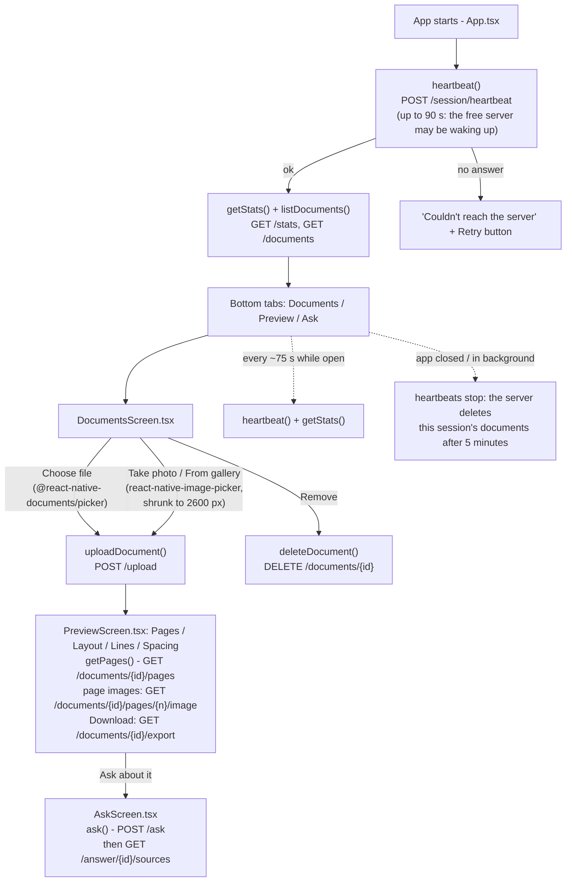

# DocBlendAI Android app

A native React Native app for the DocBlendAI server: upload a PDF, photo, Word, PowerPoint, or
text file (or take a photo of notes), see the document, and ask questions. Every answer shows
its reliability label (Certain / Moderate / Uncertain / Unreadable) and where it was found.

All reading (OCR / handwriting) and answering happens on the server
(`SERVER_URL` in [src/config.ts](src/config.ts), currently `https://docblendai.onrender.com`).
The Gemini key stays on the server; the app contains no secrets.

## Screens

| Tab | What it does |
|---|---|
| Documents | Choose files, pick photos from the gallery, or take a photo (photos are shrunk to 2600 px before upload, with live upload progress), pick the kind of writing, tick which documents to ask about, view or remove them |
| Preview | **Pages**; **Layout**: titles, text, tables (as grids), figures in reading order; **Lines**: each recognised line with its confidence; **Spacing**: the page as text with its columns kept; **Download**: layout text, Markdown, tables (CSV), JSON |
| Ask | Chat with reliability labels, suggested questions, and "Where I found this" with match and legibility scores |

The header shows visitors and questions today (same counters as the website). Documents are
private to the app session and the server deletes them a few minutes after the app is closed.

## How the app works



| File | What it does |
|---|---|
| `App.tsx` | Header with counters, "connecting" banner, the three tabs, heartbeats, Android back button |
| `src/api.ts` | Every call to the server (one function per endpoint), session and visitor ids |
| `src/config.ts` | `SERVER_URL` and the `user_id` sent with questions |
| `src/screens/DocumentsScreen.tsx` | File picker, camera, kind-of-writing chips, document list |
| `src/screens/PreviewScreen.tsx` | Pages / Layout / Lines / Spacing views and the Download menu |
| `src/screens/AskScreen.tsx` | Chat, reliability labels, suggestions, "Where I found this" |
| `src/theme.ts` | Colours, reliability label wording, confidence colours |

## APIs the app calls

All calls go through `request()` in [src/api.ts](src/api.ts): it prefixes `SERVER_URL`, adds the
`X-Session-Id` header, applies a timeout, and turns the server's `{"detail": "..."}` errors into a
message the screens show. The full API (shared with the website) is described in the
[main README](../README.md#8-api-reference-website-and-app).

| Function in `src/api.ts` | Endpoint | Used by | Timeout |
|---|---|---|---|
| `heartbeat()` | `POST /session/heartbeat` `{session_id, visitor_id}` | `App.tsx` on start, every ~75 s, on returning to the app | 90 s first time, 30 s after |
| `getStats()` | `GET /stats` | header counters | 60 s |
| `listDocuments()` | `GET /documents` | Documents tab | 60 s |
| `uploadDocument(file, hint, onProgress)` | `POST /upload` (multipart `file`, `format_hint`; XMLHttpRequest for progress) | Choose file / From gallery / Take photo | 10 min (OCR of scans is slow) |
| `deleteDocument(id)` | `DELETE /documents/{id}` | Remove button | 60 s |
| `getPages(id)` | `GET /documents/{id}/pages` | Preview tab | 60 s |
| `absoluteUrl(image_url)` | `GET /documents/{id}/pages/{n}/image`, `GET /documents/{id}/file` | `<Image>` in Preview | – |
| `exportUrl(id, format)` | `GET /documents/{id}/export?format=layout\|md\|csv\|json\|txt` | Download (opens the phone's browser) | – |
| `ask(question, docIds)` | `POST /ask`, then `GET /answer/{id}/sources` | Ask tab | 2 min |

Examples from the code:

```ts
// Upload a picked file or a camera photo (React Native sends {uri, name, type} as the file part)
const form = new FormData();
form.append('file', {uri: file.uri, name: file.name, type: file.type} as any);
if (formatHint) form.append('format_hint', formatHint); // 'typed' | 'scanned' | 'handwritten'
const doc = await request<Doc>('/upload', {method: 'POST', body: form}, 10 * 60000);

// Ask about the ticked documents
const answer = await request<Answer>('/ask', json({
  query_id: uuid(), question_text: question, user_id: 'android-app', doc_ids: docIds,
}));
const sources = await request<Source[]>(`/answer/${answer.answer_id}/sources`);
// answer.reliability_label is 'Certain' | 'Moderate' | 'Uncertain' | 'Unreadable'
```

**Sessions:** `SESSION_ID` is a new random id each time the app starts, so a new launch starts
with an empty library. `visitorId` is kept in `AsyncStorage`, so the visitor counter counts a phone
once per day. **Permissions:** only `INTERNET`. The camera opens Android's own camera app, so the
app needs no camera or storage permission.

## Installing the APK on a phone

1. Send `DocBlendAI.apk` over WhatsApp, Drive, email, or USB.
2. On the phone, tap the file. Android asks to allow installs from that app (WhatsApp, Files, ...):
   tap **Settings → Allow from this source**, go back, and tap **Install**.
3. If Play Protect warns about an unknown app, tap **More details → Install anyway**
   (it is just not from the Play Store).

The first start can take up to a minute: the free Render server sleeps when nobody uses it.

## Building the APK (Windows)

Needs Node 22+, Android Studio (its bundled JDK 17, the Android SDK, and NDK 27.1.12297006 from
Android Studio → Settings → Android SDK → SDK Tools).

Windows limits file paths to 260 characters, and the native build's paths get too long inside
a deep folder like `OneDrive\Documents\Desktop\...` ("Filename longer than 260 characters").
Build from a short folder instead, e.g. copy `mobile` to `C:\dba` (don't exclude folders named
`build`: some libraries in `node_modules` need theirs):

```bash
robocopy mobile C:\dba /E /XD .cxx .gradle
cd C:\dba
npm install
cd android
set JAVA_HOME=C:\Program Files\Android\Android Studio\jbr
gradlew.bat assembleRelease
```

The APK is `android/app/build/outputs/apk/release/app-release.apk`.

`android/local.properties` must point at the SDK (`sdk.dir=C\:\\Users\\<you>\\AppData\\Local\\Android\\Sdk`);
Android Studio creates it when you open the `android` folder once.

## Signing key (keep it safe)

Release builds are signed with `android/app/docblendai-release.keystore`, whose passwords are in
`android/keystore.properties`. Both are git-ignored. **Back them up privately** (e.g. a private
Drive folder): a new APK installs as an update over the old one only if it is signed with the same
key. Without `keystore.properties` the build falls back to the debug key.

To make a new key: `keytool -genkeypair -v -storetype PKCS12 -keystore app/docblendai-release.keystore
-alias docblendai -keyalg RSA -keysize 2048 -validity 10000`, then fill in `keystore.properties`
(`storeFile`, `storePassword`, `keyAlias`, `keyPassword`).

## Changing the server

Edit `SERVER_URL` in `src/config.ts` and build again. When testing against a server on your own PC
from the Android emulator, use `http://10.0.2.2:8000` (plain http also needs
`usesCleartextTraffic` enabled for release builds).
